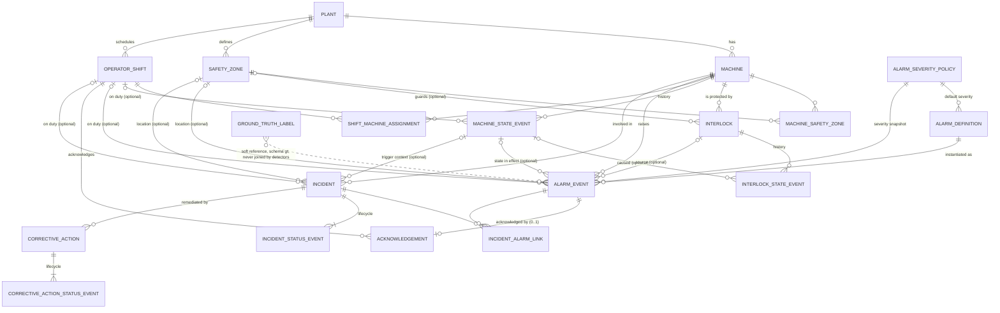

# ER Diagram and Relationships

Render with any Mermaid viewer (VS Code "Markdown Preview Mermaid Support", GitHub, mermaid.live).

`GROUND_TRUTH_LABEL` lives in Postgres schema `gt` and references records by `(record_table, record_id)` text with **no foreign key**, so it cannot influence features or constraints.

## Cardinality and optionality

| Relationship | Cardinality | Optional side / notes |
|---|---|---|
| Plant → Machine | 1:N | Machine must have a plant |
| Plant → SafetyZone | 1:N | |
| Machine ↔ SafetyZone | **N:M** via `machine_safety_zone` | Effective-dated; both must belong to same plant; no overlapping periods for the same pair |
| Machine → Interlock | 1:N | |
| SafetyZone → Interlock | 1:N | `interlock.safety_zone_id` optional (e.g. machine-wide E-stop); if set, zone must be linked to the machine |
| Interlock → InterlockStateEvent | 1:N | append-only, ordered by `sequence_no` |
| Machine → MachineStateEvent | 1:N | append-only; first event has `previous_state` NULL |
| OperatorShift ↔ Machine | **N:M** via `shift_machine_assignment` | |
| AlarmDefinition → AlarmEvent | 1:N | |
| Machine → AlarmEvent | 1:N | |
| AlarmEvent → MachineStateEvent | N:1 optional | NULL for alarms not tied to a state (e.g. comms loss) |
| AlarmEvent → Acknowledgement | **1:0..1** (one-to-one, optional) | Missing row = unacknowledged |
| OperatorShift → Acknowledgement | 1:N | |
| Machine → Incident | 1:N | |
| Incident ↔ AlarmEvent | **N:M** via `incident_alarm_link` | Normal incident has ≥1 `TRIGGER`; zero links = anomaly 3 |
| Incident → MachineStateEvent | N:1 optional | NULL trigger context = anomaly 3 |
| Incident → IncidentStatusEvent | 1:N (≥1) | History; `incident.status` = latest event |
| Incident → CorrectiveAction | 1:N, optional (0 while open) | |
| CorrectiveAction → CorrectiveActionStatusEvent | 1:N (≥1) | History; `status` = latest event |

## Lifecycle states

| Entity | States | Allowed transitions |
|---|---|---|
| Plant / Machine / SafetyZone / Interlock / AlarmDefinition | `lifecycle_status` + `effective_from` / `effective_to` | ACTIVE → (SUSPENDED/MAINTENANCE/DISABLED/DEPRECATED) → RETIRED; effective ranges never overlap for the same logical row |
| Machine operating state | RUNNING, IDLE, STOPPED, E_STOPPED, FAULT, MAINTENANCE | STOPPED→IDLE,MAINTENANCE · IDLE→RUNNING,STOPPED · RUNNING→IDLE,STOPPED,E_STOPPED,FAULT · E_STOPPED→STOPPED · FAULT→STOPPED · MAINTENANCE→STOPPED |
| Alarm | ACTIVE → CLEARED; acknowledgement is a separate record | ack may occur while ACTIVE or after CLEARED |
| Incident | OPEN → INVESTIGATING → ACTION_IN_PROGRESS → RESOLVED → CLOSED | CLOSED requires all actions CLOSED and ≥1 action |
| Corrective action | PLANNED → IN_PROGRESS → COMPLETED → VERIFIED → CLOSED; PLANNED/IN_PROGRESS → CANCELLED | CLOSED requires verification PASSED; FAILED verification ends the action in VERIFIED and a new `-02` action is created |
